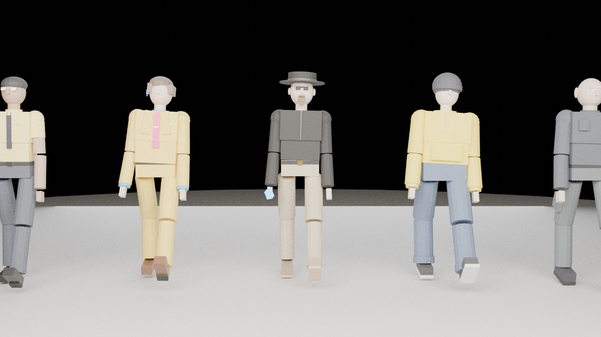
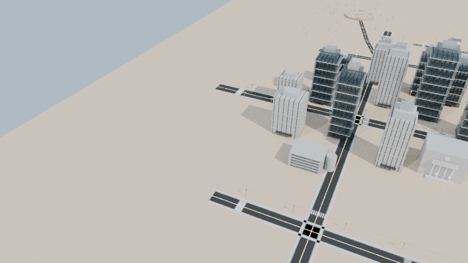
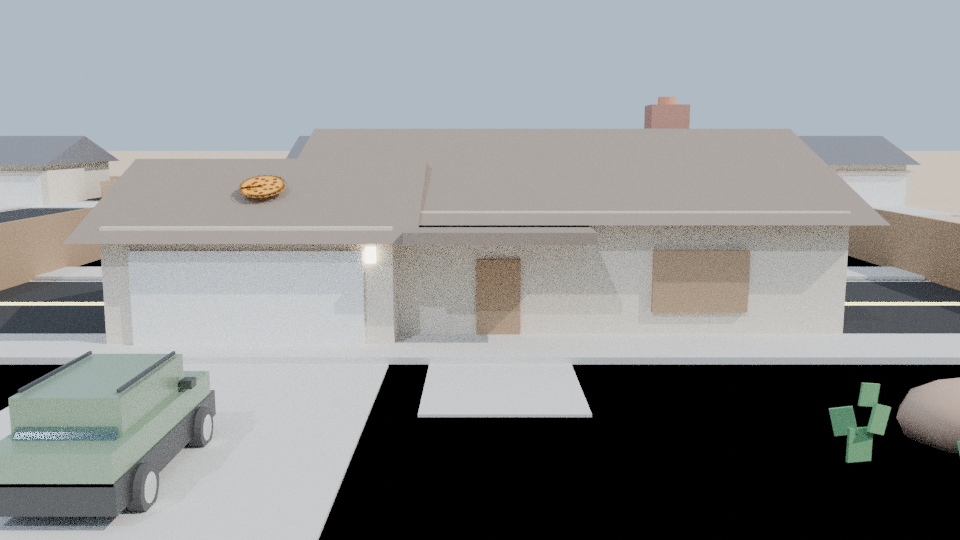
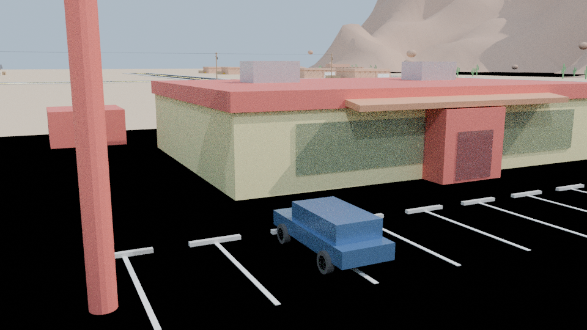
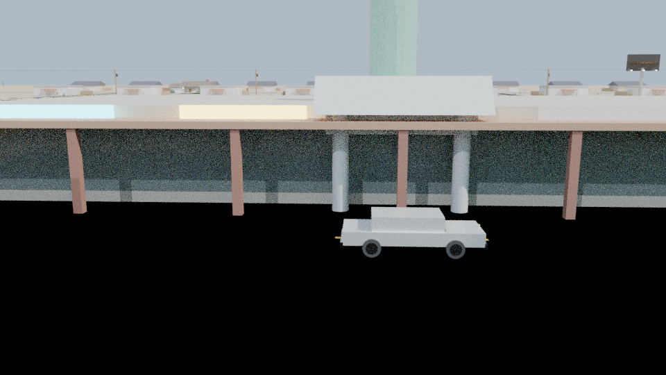

# Breaking Bad 3D: Open-World Albuquerque & Character Studio

[](https://www.blender.org/)
[](https://threejs.org/)
[](https://www.khronos.org/gltf/)
[](https://developer.mozilla.org/en-US/docs/Web/API/WebGL2RenderingContext)

A high-fidelity **1.44 km² (1200m × 1200m) 3D recreation of Albuquerque, New Mexico** and a complete **rigged humanoid character suite** from *Breaking Bad* and *Better Call Saul*, developed in **Blender 4.0** for open-world game creation and interactive WebGL exploration.

---

## 📸 Showcase Renders

### The 5-Character Ensemble Lineup

*From left to right: Gustavo Fring (surgical cadence), Saul Goodman (courtroom hustle), Walter White / Heisenberg (authority & menace), Jesse Pinkman (street swagger), and Mike Ehrmantraut (methodical enforcer).*

### Albuquerque Open-World Aerial Overview


### Iconic Landmarks
| Walter White Residence (308 Negra Arroyo Lane) | Los Pollos Hermanos Flagship |
| :---: | :---: |
|  |  |

| Saul Goodman's Office & Inflatable Liberty | Subterranean Superlab (Lavandería Brillante) |
| :---: | :---: |
|  |  |

---

## 🎭 Character Studio & Walk Cycle Rigging

All five characters are modeled with separate limb geometry, parented to standard biped humanoid armatures (`Root`, `Spine`, `Chest`, `Neck`, `Head`, `Clavicles`, `Arms`, `Hands`, `Legs`, `Feet`), and animated with **personality-driven 30-frame walk cycle loops** and **60-frame idle stances** exported as glTF actions:

| Character | Costume & Features | Walk Kinematics Profile | Assets |
| :--- | :--- | :--- | :--- |
| **Walter White (Heisenberg)** | Porkpie hat, dark sunglasses, sculpted goatee, black windbreaker, khaki chinos, Wallabee suede shoes, glowing 99.1% pure Blue Sky crystal. | **Authority & Menace**: Measured 0.72m stride, rigid 4° lean, controlled arm swing, locked forward predatory gaze. | [Blend](assets/characters/heisenberg.blend) / [GLB](assets/characters/heisenberg.glb) |
| **Jesse Pinkman** | Slouchy knit beanie, oversized bright yellow streetwear hoodie with pouch & drawstrings, baggy denim jeans, skater sneakers. | **Street Swagger**: Rhythmic 5.2cm vertical bounce, loose shoulders, swaying elbows, attitude-filled head bob. | [Blend](assets/characters/jesse_pinkman.blend) / [GLB](assets/characters/jesse_pinkman.glb) |
| **Saul Goodman** | Flamboyant mustard double-breasted suit, electric blue shirt, magenta silk tie with gold clip, Bluetooth headset with blue LED, Italian dress oxfords. | **Courtroom Hustle**: Fast 14° forward pitch, active knees, dramatic wide swinging arms, expressive gesturing hands. | [Blend](assets/characters/saul_goodman.blend) / [GLB](assets/characters/saul_goodman.glb) |
| **Gustavo "Gus" Fring** | Los Pollos Hermanos yellow button-up manager shirt with name badge, skinny dark clip tie with silver clip, spectacles, charcoal slacks, black oxfords. | **Surgical Cadence**: Clockwork precision, 0° zero-slouch vertical spine, disciplined arms at sides, chilling calm. | [Blend](assets/characters/gus_fring.blend) / [GLB](assets/characters/gus_fring.glb) |
| **Mike Ehrmantraut** | Weathered bald cranium, furrowed brow scowl, tactical windbreaker with storm collar, cargo pants with side pockets, combat boots. | **Methodical Enforcer**: Heavy grounded footfalls, stoic center of gravity, 2.4cm deep foot sinking, vigilant patrol stance. | [Blend](assets/characters/mike_ehrmantraut.blend) / [GLB](assets/characters/mike_ehrmantraut.glb) |
| **Ensemble Lineup** | All 5 characters walking side-by-side on comparative pedestal. | Synchronized comparative walk cycles with individual armatures. | [Blend](assets/characters/breaking_bad_lineup.blend) / [GLB](assets/characters/breaking_bad_lineup.glb) |

---

## 🏙️ Albuquerque 3D City Features

- **Map Bounds**: 1200m × 1200m ($1.44\text{ km}^2$) with graded terrain and Sandia Mountains backdrop.
- **Road Network**: Dual-lane boulevards, Route 66 / Central Ave, cul-de-sacs, yellow curbs, storm drains, street signs.
- **10 Iconic Landmarks**:
  1. 308 Negra Arroyo Lane (Walter White's residence, backyard pool, pergola, rooftop pizza)
  2. Los Pollos Hermanos (Restaurant, spinning roadside twin chicken sign, drive-thru)
  3. Saul Goodman & Associates Law Office (Strip mall, 5.5m inflatable Statue of Liberty, Cadillac DeVille)
  4. A1A Deluxe Car Wash (Double wash tunnel, glass lobby, large water pump tanks)
  5. Lavandería Brillante & Subterranean Superlab (Epoxy floors, 500-gallon stainless steel reactors, methylamine barrels)
  6. To'hajiilee Indian Reservation Desert Cook Site (Red sand cliffs, dead brush, bullet-riddled 1986 RV)
  7. Crossroads Motel ("The Crystal Palace")
  8. Tuco Salamanca's Headquarters
  9. Los Lunas Desert Rail Siding
  10. Bernalillo County Courthouse & Plaza
- **Drivable Show Vehicles**:
  - Pontiac Aztek (Fern Green)
  - 1986 Fleetwood Bounder RV ("The Crystal Ship")
  - 1997 Cadillac DeVille (White, `LWYRUP` license plate)
  - 1986 Volvo 240 DL (Navy Blue)
  - 1970 Chevrolet Monte Carlo (Cherry Red with lowrider suspension)

---

## 🌐 Interactive Web Viewers

The repository includes standalone WebGL viewers built with Three.js:

1. **Character Studio & Walk Inspector** (`characters.html`):
   - 360° orbit inspection
   - Character selector
   - Real-time skeleton wireframe helper (`THREE.SkeletonHelper`)
   - Play/pause and speed slider ($0.1\times$ to $2.0\times$)
   - Camera angle presets (Full Body, Portrait, Profile, Footwork)
2. **3D Road Navigator** (`drive.html`):
   - First-person / third-person road driving and navigation
   - Minimap and GPS waypoint navigation
3. **Master Showcase & Map Explorer** (`index.html`):
   - Interactive district map, landmark directory, vehicle showcase, downloads

To run locally:
```bash
python3 -m http.server 8080
# Open http://localhost:8080/characters.html or http://localhost:8080
```

---

## 📁 Repository Structure

```
BB/
├── assets/
│   ├── characters/       # .blend & rigged .glb character files
│   │   ├── heisenberg.blend / .glb
│   │   ├── jesse_pinkman.blend / .glb
│   │   ├── saul_goodman.blend / .glb
│   │   ├── gus_fring.blend / .glb
│   │   ├── mike_ehrmantraut.blend / .glb
│   │   └── breaking_bad_lineup.blend / .glb
│   ├── landmarks/        # Individual landmark .blend & .glb models
│   ├── vehicles/         # Vehicle models with separated wheel pivots
│   ├── modular/          # Road segments, curbs, buildings
│   └── props/            # Barrels, signs, cacti, utility poles
├── world/
│   └── breaking_bad_albuquerque_master.blend  # Master 25MB city scene
├── game_export/
│   └── breaking_bad_albuquerque_master.glb    # Master 11MB city glTF
├── renders/              # High-res Cycles showcase beauty renders
├── scripts/              # Procedural generators & export pipelines
│   ├── characters_gen.py # Armatures, kinematics & character meshes
│   ├── export_characters.py
│   ├── city_builder.py   # Albuquerque procedural city assembler
│   ├── landmarks_gen.py
│   ├── vehicles_gen.py
│   └── materials_lib.py  # 100+ PBR materials library
├── js/                   # Local Three.js, GLTFLoader, OrbitControls
├── index.html            # Master city explorer web interface
├── characters.html       # 3D Character Studio & Walk Inspector
└── drive.html            # 3D Road Navigator
```

---

## 🚀 Game Engine Import

All assets are exported to **glTF 2.0 binary format (`.glb`)** with embedded skeletal armatures, animations, and PBR textures:
- **Unreal Engine 5**: Drag `.glb` into Content Browser -> Import Skeletal Mesh & Animations.
- **Unity**: Drop `.glb` into Project view -> Set Rig to Humanoid / Generic -> Import Animations.
- **Godot 4**: Drop `.glb` into FileSystem -> Instantiates `Node3D` with `AnimationPlayer` and `Skeleton3D`.
